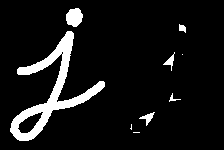
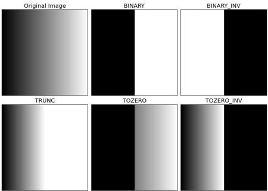

# SIIM-ISIC Melanoma Classification: CNN + LIME

## [1/9] Overview

- **Data** → [SIIM-ISIC Melanoma Classification](https://www.kaggle.com/competitions/siim-isic-melanoma-classification)
- **Task** → dermoscopic image → benign (0) / malignant (1)
- **Metric** → ROC-AUC
- **Notebook** → `melanoma_classification_cnn_lime.ipynb`
- **Backup** → `arch/` (original version)

## [2/9] Run on Kaggle

- **Accelerator** → GPU
- **Internet** → On (ImageNet weights, `pip install lime`)
- **Settings** → top cell of the notebook, documented in its note
- **Safety** → every write is off by default; the notebook only previews
  - `WRITE_CACHE = False` → images are not cached to `.npz`
  - `SAVE_MODEL = False` → model file is not written
  - `SAVE_SUBMISSION = False` → predicts `SUBMISSION_PREVIEW` test images, writes nothing
- **Lighter run** → lower `IMG_SIZE`, `N_BENIGN` (e.g. 1000), epochs or `LIME_SAMPLES`
- **More data** → raise `N_BENIGN` (e.g. 8000); memory grows ~150 KB per image at 224 px

## [3/9] Metadata EDA

- **Scope** → full train set (33,126 images), not the modeling sample → real rates
- **Class imbalance** → 584 malignant (1.76%)
  - always predicting "benign" scores ~98% accuracy → accuracy is misleading → ROC-AUC
- **Diagnosis vs target** → `diagnosis` is known only after biopsy; every `melanoma` is malignant
  - leakage → never a model input
- **Malignancy rate by site / sex / age** → bar = share of malignant images, dashed line = overall rate
  - error bar = 95% Wilson confidence interval → small groups have wide intervals → may be noise
  - rate rises with age: ~1% under 50 → ~9% at 80+
- **Patient structure** → 2,056 patients, median 12 images each, 0% of test patients in train
  - same patient in train and test → model recognises the patient (skin tone, camera, lighting) → inflated scores
  - → our split is grouped by patient

## [4/9] Sampling and split

- **Sampling** → all 584 malignant images + `N_BENIGN` = 5,000 random benign images → 5,584 images
  - 6× lighter than the full set, 3.5× more images than a 1,000-benign sample
  - evaluation on this sample is ~10.5% malignant vs 1.76% in real data
- **Split** → `StratifiedGroupKFold`: each patient in exactly one split, similar class ratio
  - test ≈ 1/7 of patients → validation ≈ 1/6 of the rest → ~70 / 15 / 15
  - train 3,986 (416 malignant) · validation 797 (83) · test 801 (85)
  - the notebook stops with an assertion if a patient appears in two splits

## [5/9] Images

- **Loading**
  - **Draft mode** → JPEGs decoded at 1/2, 1/4 or 1/8 scale (originals up to ~6000×4000 px)
  - **Threads** → `N_JOBS` images decoded in parallel
  - **Cache** → `.npz` in `WORK_DIR` when `WRITE_CACHE = True`; re-runs load it if the image list matches
- **Original resolution vs target** → resolution ≈ clinic / camera
  - if it tracks the target, the CNN may learn the acquisition source (borders, blur, colour) instead of the lesion
  - only the JPEG header is read → cheap
- **Colour and contrast** → per-image mean R / G / B and pixel std, as densities per class
  - each class normalised separately → class sizes don't matter
  - differences = colour cues for the CNN, or camera differences (see resolution table)

## [6/9] Hair removal and augmentation

- **Hair removal** → hair covers parts of the lesion and can mislead the CNN
  1. **Grayscale** → RGB → gray
  2. **Kernel** → 17×17 rectangle (`cv2.MORPH_RECT`); other shapes: `MORPH_ELLIPSE`, `MORPH_CROSS`
  3. **Blackhat** → closing − image → highlights thin dark structures (hair) on lighter skin

     
  4. **Threshold** → binary hair mask

     
  5. **Inpaint** (Telea) → fills the masked pixels from their neighbours

     
- **Augmentation** → over-sample malignant images in the training split only → no augmented copies of val/test images leak into training
  - `AUG_PER_MALIGNANT` = 2 copies per image → 416 + 832 = 1,248 malignant vs 3,570 benign
  - capped → thousands of copies of 416 lesions would teach the same lesions over and over
  - each new image = one training image + one random method
  - **`transform_image`** → rotate ±10°, zoom ×1.1; `BORDER_REPLICATE` fills corners with edge pixels
  - **`random_fscb`** → random flip, saturation, contrast, brightness
  - **`hair_remove`** → the same lesion without hair
- **References**
  - [SIIM Melanoma Competition: EDA + Augmentations (Andrada)](https://www.kaggle.com/code/andradaolteanu/siim-melanoma-competition-eda-augmentations)
  - [OpenCV morphological transformations](https://docs.opencv.org/4.x/d9/d61/tutorial_py_morphological_ops.html)
  - [OpenCV thresholding](https://opencv24-python-tutorials.readthedocs.io/en/latest/py_tutorials/py_imgproc/py_thresholding/py_thresholding.html)
  - [OpenCV inpainting](https://docs.opencv.org/3.4/df/d3d/tutorial_py_inpainting.html)
  - [OpenCV geometric transformations](https://docs.opencv.org/4.x/da/d54/group__imgproc__transform.html)
  - [tf.image](https://www.tensorflow.org/api_docs/python/tf/image)

## [7/9] Modeling

- **Model** → EfficientNetB0 pre-trained on ImageNet + new sigmoid head
  - **Input 0-255** → Keras' EfficientNet rescales internally
  - **Online augmentation** → random flip / rotation / zoom inside the model (training only)
  - **Frozen BatchNorm** → backbone called with `training=False`, also when fine-tuning
  - **Mixed precision** on GPU → float16 compute, float32 output → faster, less memory
- **Class weights** → `n / (2 · n_class)` → benign ≈ 0.67, malignant ≈ 1.93 → closes the remaining gap in the loss
- **[1/2] Head** → backbone frozen, Adam `1e-3`, up to `EPOCHS_HEAD`
- **[2/2] Fine-tune** → last `FINE_TUNE_LAST_N` backbone layers unfrozen, Adam `1e-5`, up to `EPOCHS_FINE_TUNE`
- **Best weights** → early stopping on validation AUC per phase; the head weights are restored if fine-tuning didn't beat them (kept in memory, no checkpoint file)

## [8/9] Evaluation and LIME

- **Threshold** → chosen on validation (max Youden's J = TPR − FPR), applied unchanged to test
- **ROC-AUC** → independent of the class ratio → comparable to real data
- **Precision** → depends on the class ratio: test is ~10.6% malignant vs 1.76% in reality → real-world precision is much lower
- **Charts** → ROC, precision-recall, predicted-probability histogram, confusion matrix
- **LIME** → hide random superpixels → fit a linear model to the CNN's outputs → one weight per superpixel
  - green → towards malignant, red → towards benign
  - one test image per confusion-matrix cell
  - trustworthy → focuses on the lesion; suspicious → hair, rulers, ink marks, dark corners

## [9/9] Next steps

- **All the data** → all 32,542 benign images from a pre-resized (256×256) copy of the JPEGs → fast loading; external malignant images (e.g. ISIC 2019)
- **Metadata** → combine age / sex / site with image features (rates differ by group)
- **Shortcut check** → predictions shouldn't follow image resolution / acquisition source
- **Bigger run** → higher resolution, k-fold ensemble, test-time augmentation
